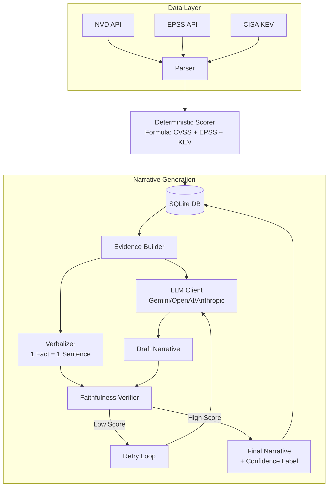
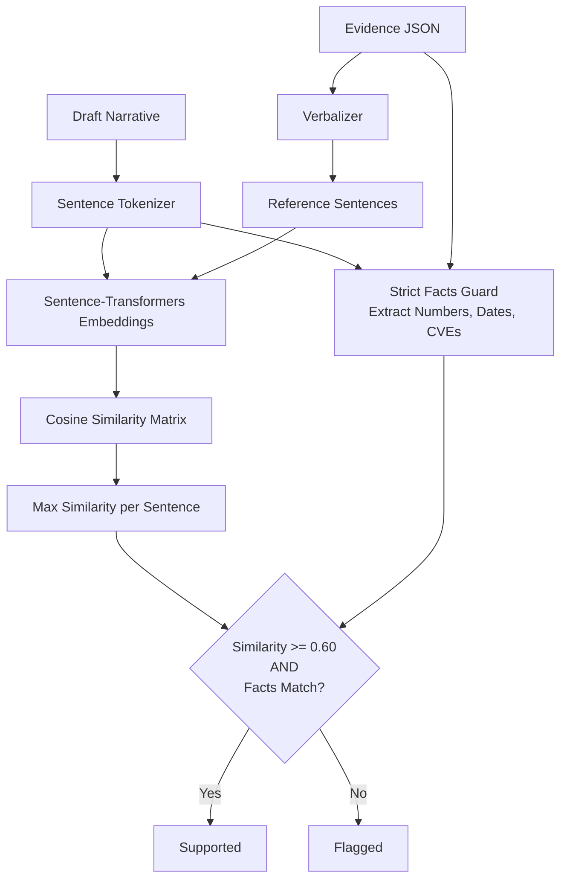

# Architecture Overview

## System Flow

## The Faithfulness Verifier

The verifier is the core defense against LLM hallucinations. It guarantees that the risk narrative is bounded by the ingested evidence.

